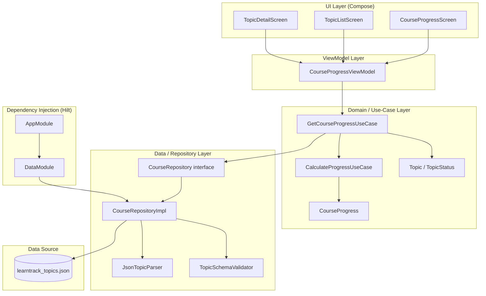

# LearnTrack — Architecture

**Phase:** Architecture and Data Design (Phase Group 2)
**Status:** Baseline — pre-scaffold; all values are design targets derived from platform determination and org conventions.
**Last Updated:** Phase Group 2

---

## 1. Application Layers and Responsibilities

LearnTrack follows the MVVM + Repository pattern established in the sibling MediHistory-AI project. All layers are Kotlin-only with Jetpack Compose as the UI framework.

```
┌──────────────────────────────────────────────┐
│  UI Layer (Compose Screens)                  │
│  CourseProgressScreen, TopicListScreen,      │
│  TopicDetailScreen                           │
│  — Stateless composables; collect UiState    │
│    from ViewModel via StateFlow              │
└────────────────┬─────────────────────────────┘
                 │ observes
┌────────────────▼─────────────────────────────┐
│  ViewModel Layer                             │
│  CourseProgressViewModel                     │
│  — Exposes StateFlow<CourseUiState>          │
│  — Calls use-case / repository               │
│  — Maps domain model to UiState             │
│  — Handles errors and loading states        │
└────────────────┬─────────────────────────────┘
                 │ calls
┌────────────────▼─────────────────────────────┐
│  Domain / Use-Case Layer                     │
│  GetCourseProgressUseCase                    │
│  CalculateProgressUseCase                    │
│  — Pure Kotlin; no Android dependencies     │
│  — Enforces business rules (count, %)       │
│  — Independently unit-testable              │
└────────────────┬─────────────────────────────┘
                 │ calls
┌────────────────▼─────────────────────────────┐
│  Data / Repository Layer                     │
│  CourseRepository (interface)               │
│  CourseRepositoryImpl                        │
│  — Reads learntrack_topics.json from assets  │
│  — Parses and validates JSON                │
│  — Returns Flow<List<Topic>>                │
└────────────────┬─────────────────────────────┘
                 │ reads
┌────────────────▼─────────────────────────────┐
│  Data Source                                 │
│  app/src/main/assets/learntrack_topics.json  │
│  — Static JSON bundled with the APK         │
│  — Single source of truth for topic data    │
└──────────────────────────────────────────────┘
```

### Layer Responsibilities

| Layer | Responsibility | Key Classes |
|---|---|---|
| UI | Render state, handle user input, navigate | `CourseProgressScreen`, `TopicListScreen`, `TopicDetailScreen` |
| ViewModel | State transformation, coroutine scope, lifecycle | `CourseProgressViewModel` |
| Use Case | Progress calculation, business validation | `GetCourseProgressUseCase`, `CalculateProgressUseCase` |
| Repository | Data access abstraction, JSON parsing | `CourseRepository`, `CourseRepositoryImpl` |
| Data Source | Bundled static JSON asset | `learntrack_topics.json` |
| DI | Hilt modules wiring layers together | `AppModule`, `DataModule` |

---

## 2. Topic Data Model and Status Representation

### Domain Model

```kotlin
data class Topic(
    val id: String,           // unique, non-empty
    val name: String,         // display name, non-empty
    val status: TopicStatus   // enum
)

enum class TopicStatus {
    COMPLETED,
    NOT_STARTED
}
```

### Status Representation in JSON

JSON uses lowercase string values that map directly to the enum:

| JSON value | Kotlin enum | Display label |
|---|---|---|
| `"completed"` | `TopicStatus.COMPLETED` | Completed |
| `"not_started"` | `TopicStatus.NOT_STARTED` | Not Started |

Any other value is treated as a validation error.

### Authoritative Distribution

| Metric | Value |
|---|---|
| Total topics | 41 |
| Completed | 22 |
| Not started | 19 |
| Completion % | 53.66% → displayed as 53.7% |

---

## 3. Data Source of Truth

**Single source of truth: `app/src/main/assets/learntrack_topics.json`**

- The JSON file is bundled inside the APK via the `assets/` directory.
- It is read-only at runtime; users cannot modify topic statuses through the app.
- Changes to topic data are development-time operations: edit the JSON, validate it, commit it, and ship a new build.
- No remote API, backend, or cloud sync is involved.
- No Room database is required for this phase; the asset file is sufficient for a read-only data model.

If the requirement for mutable runtime status ever arises, Room is the prescribed persistence layer (see Section 7).

---

## 4. JSON Import and Validation Workflow

```
App startup
    │
    ▼
CourseRepositoryImpl.getTopics()
    │
    ├─► Open AssetManager stream for learntrack_topics.json
    │       └─ IOException → emit Error state ("File not found")
    │
    ├─► Parse JSON using kotlinx.serialization or Moshi
    │       └─ JsonDataException / ParseException → emit Error state ("Malformed JSON")
    │
    ├─► Validate schema
    │       ├─ Each topic has non-empty id and name
    │       ├─ Each status value is in {"completed", "not_started"}
    │       └─ Validation failure → emit Error state ("Invalid schema")
    │
    ├─► Validate counts (optional strict mode)
    │       ├─ total == 41
    │       ├─ completed == 22
    │       ├─ not_started == 19
    │       └─ Count mismatch → emit Warning or Error (configurable)
    │
    └─► Emit Success(List<Topic>)
```

### Validation Rules

| Rule | Field | Constraint |
|---|---|---|
| Non-empty id | `id` | String, not blank |
| Unique id | `id` | No duplicates across the list |
| Non-empty name | `name` | String, not blank |
| Valid status | `status` | Must be `"completed"` or `"not_started"` |
| Total count | list | Exactly 41 entries |
| Completed count | status==completed | Exactly 22 |
| Not-started count | status==not_started | Exactly 19 |

---

## 5. Progress Calculation Flow

Progress is never hard-coded. It is always calculated from the live topic list.

```kotlin
object ProgressCalculator {
    fun calculate(topics: List<Topic>): CourseProgress {
        val total = topics.size
        val completed = topics.count { it.status == TopicStatus.COMPLETED }
        val notStarted = topics.count { it.status == TopicStatus.NOT_STARTED }
        val percentage = if (total > 0) (completed.toFloat() / total) * 100f else 0f
        return CourseProgress(
            total = total,
            completed = completed,
            notStarted = notStarted,
            completionPercentage = percentage
        )
    }
}

data class CourseProgress(
    val total: Int,
    val completed: Int,
    val notStarted: Int,
    val completionPercentage: Float  // e.g., 53.658... displayed as "53.7%"
)
```

Display rounding: `"%.1f%%".format(completionPercentage)` → `"53.7%"`

Edge cases:
- Zero topics → percentage = 0.0%
- All completed → percentage = 100.0%
- None completed → percentage = 0.0%

---

## 6. Persistence and Synchronization Behavior

| Scenario | Behavior |
|---|---|
| Read-only topic data (current phase) | Load from `assets/learntrack_topics.json` on every cold start |
| No caching needed | Asset reads are fast; the file is small (~5 KB) |
| No network sync | No backend; no sync required |
| Data changes | Edit JSON file at development time; ship new build |
| Future mutable status | Add Room database; seed from asset on first launch; sync to DB |

**Current phase:** Assets only. Room is out of scope unless a mutable-status requirement is approved.

---

## 7. UI State Management Approach

Each screen's ViewModel exposes a single `StateFlow<UiState>` sealed class.

```kotlin
sealed class CourseUiState {
    object Loading : CourseUiState()
    data class Success(val progress: CourseProgress, val topics: List<Topic>) : CourseUiState()
    data class Error(val message: String) : CourseUiState()
    object Empty : CourseUiState()  // topics list returned but is empty
}
```

**Composable pattern:**

```kotlin
@Composable
fun CourseProgressScreen(viewModel: CourseProgressViewModel = hiltViewModel()) {
    val uiState by viewModel.uiState.collectAsStateWithLifecycle()
    when (uiState) {
        is CourseUiState.Loading -> LoadingIndicator()
        is CourseUiState.Success -> CourseProgressContent(uiState as CourseUiState.Success)
        is CourseUiState.Error   -> ErrorMessage((uiState as CourseUiState.Error).message)
        is CourseUiState.Empty   -> EmptyState()
    }
}
```

- Composables are stateless and observe ViewModel state only.
- State is hoisted to ViewModel; no local mutable state for data (only UI ephemeral state).
- Lifecycle-aware collection via `collectAsStateWithLifecycle()`.

---

## 8. Error Handling and Logging

### Error Categories

| Error | Source | UiState | User-visible message |
|---|---|---|---|
| JSON file missing | `AssetManager` | `Error` | "Course data could not be loaded." |
| Malformed JSON | Parser | `Error` | "Course data is invalid." |
| Schema violation | Validator | `Error` | "Course data has an unexpected format." |
| Empty topic list | Repository | `Empty` | Empty state screen shown |
| Unknown status value | Validator | `Error` | "Course data has an unexpected format." |

### Logging

- Use `android.util.Log` with tag `"LearnTrack"` at `DEBUG` level for data-load events.
- Log errors with `Log.e` including the exception message; never log raw JSON content in production builds.
- `BuildConfig.DEBUG` guards verbose logging blocks.

### No Crash Policy

All exceptions from JSON parsing and asset loading are caught at the repository boundary and converted to `Result<T>` or `Flow` error emissions. The app must never crash due to data loading.

---

## 9. Testing Boundaries and Integration Points

| Test type | Scope | Framework | Key targets |
|---|---|---|---|
| Unit — Progress calc | `ProgressCalculator` | JUnit 4/5 | All edge cases (0, all, partial) |
| Unit — Repository | `CourseRepositoryImpl` | JUnit + MockK | Valid JSON, missing file, malformed JSON |
| Unit — ViewModel | `CourseProgressViewModel` | JUnit + MockK | State transitions Loading→Success/Error |
| Unit — Use case | `GetCourseProgressUseCase` | JUnit | Delegates correctly, returns progress |
| Integration — JSON schema | `learntrack_topics.json` | JUnit | Count 41, status distribution 22/19 |
| UI — Dashboard | `CourseProgressScreen` | Compose UI Test | Progress %, counts, loading, error |
| UI — Topic list | `TopicListScreen` | Compose UI Test | 41 rows, status badges, scroll |
| UI — Topic detail | `TopicDetailScreen` | Compose UI Test | Name, status, back navigation |
| Regression | Data distribution | JUnit | Assert 22/19/41 never drifts |

Test file locations:
- Unit tests: `app/src/test/java/com/learntrack/`
- Instrumented / UI tests: `app/src/androidTest/java/com/learntrack/`

---

## 10. Dependency Diagram



---

## 11. Key File Paths (Target State)

| Path | Description |
|---|---|
| `app/src/main/assets/learntrack_topics.json` | Course topic data — single source of truth |
| `app/src/main/java/com/learntrack/data/model/Topic.kt` | Domain model |
| `app/src/main/java/com/learntrack/data/repository/CourseRepository.kt` | Repository interface |
| `app/src/main/java/com/learntrack/data/repository/CourseRepositoryImpl.kt` | Repository implementation |
| `app/src/main/java/com/learntrack/domain/usecase/GetCourseProgressUseCase.kt` | Use case |
| `app/src/main/java/com/learntrack/domain/usecase/CalculateProgressUseCase.kt` | Progress calculation |
| `app/src/main/java/com/learntrack/ui/progress/CourseProgressViewModel.kt` | ViewModel |
| `app/src/main/java/com/learntrack/ui/progress/CourseProgressScreen.kt` | Dashboard composable |
| `app/src/main/java/com/learntrack/ui/topics/TopicListScreen.kt` | Topic list composable |
| `app/src/main/java/com/learntrack/ui/topics/TopicDetailScreen.kt` | Topic detail composable |
| `app/src/test/java/com/learntrack/domain/ProgressCalculatorTest.kt` | Progress unit tests |
| `app/src/test/java/com/learntrack/data/repository/CourseRepositoryImplTest.kt` | Repository unit tests |
| `app/src/androidTest/java/com/learntrack/ui/CourseProgressScreenTest.kt` | UI tests |

---

## References

- Discovery report: `docs/discovery/learntrack-discovery-report.md`
- Scope document: `docs/scope/learntrack-scope.md`
- Master prompt: `docs/learntrack-ai-sdlc-master-prompt.md`
- Data flow: `docs/architecture/learntrack-data-flow.md`
- Environments: `docs/architecture/learntrack-environments.md`
- Kiro spec: `.kiro/specs/course-progress-update/design.md`
