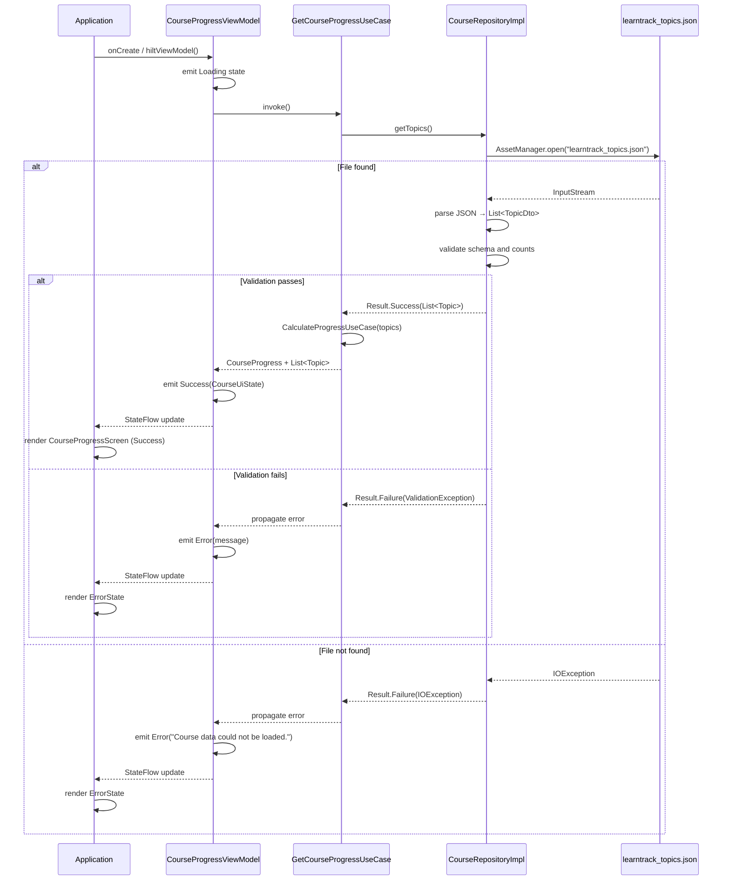
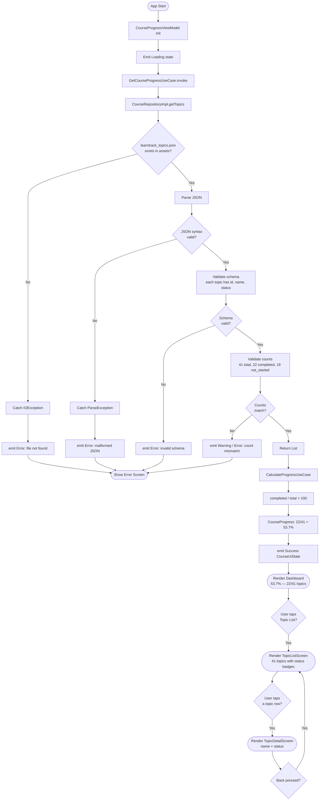
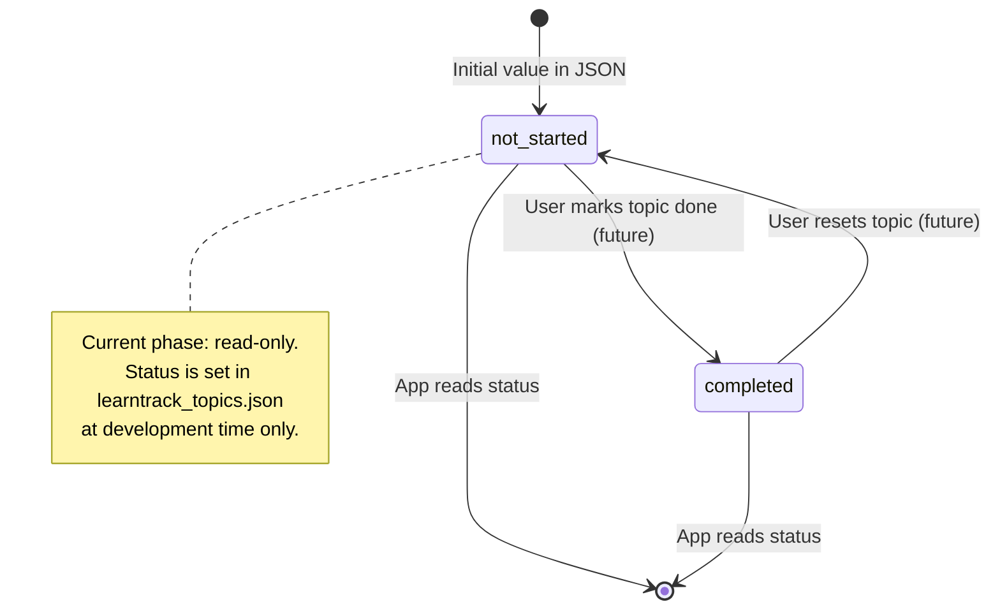
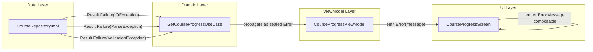

# LearnTrack — Data Flow

**Phase:** Architecture and Data Design (Phase Group 2)
**Status:** Baseline — pre-scaffold; describes target state derived from platform determination.
**Last Updated:** Phase Group 2

---

## 1. End-to-End Data Flow Overview

```
learntrack_topics.json (asset)
        │
        │  AssetManager.open()
        ▼
CourseRepositoryImpl
        │  parse + validate
        ▼
List<Topic>  ─────────────────────────────────────────────────┐
        │                                                      │
        │  GetCourseProgressUseCase                            │
        ▼                                                      ▼
CalculateProgressUseCase                               Full topic list
        │                                                      │
        ▼                                                      │
CourseProgress(total, completed, notStarted, %)               │
        │                                                      │
        └─────────────────────┬────────────────────────────────┘
                              │  CourseProgressViewModel
                              ▼
                    CourseUiState (sealed)
                              │
                ┌─────────────┼─────────────┐
                ▼             ▼             ▼
           Loading         Success        Error / Empty
                              │
              ┌───────────────┼───────────────┐
              ▼               ▼               ▼
  CourseProgressScreen  TopicListScreen  TopicDetailScreen
```

---

## 2. Sequence Diagram — App Startup to Dashboard Render



---

## 3. Flowchart — Full Data Pipeline



---

## 4. State Transitions for Topic Status

Topic status is static in the current phase (read-only JSON). The state machine below captures the intended lifecycle if mutability is added in a future phase.



**Current phase constraint:** Status transitions are not possible at runtime. The only valid state transitions are:
- Development-time edit of `learntrack_topics.json`
- Followed by validation, commit, and new build

---

## 5. Progress Calculation Algorithm

```
Input:  topics: List<Topic>
Output: CourseProgress

Algorithm:
  1. total     ← topics.size
  2. completed ← count where topic.status == COMPLETED
  3. notStarted← count where topic.status == NOT_STARTED
  4. IF total > 0:
       percentage ← (completed / total) × 100.0
     ELSE:
       percentage ← 0.0
  5. Return CourseProgress(total, completed, notStarted, percentage)

Display: "%.1f%%".format(percentage)
  → 53.658...% → "53.7%"
```

**Authoritative test vectors:**

| Input | completed | total | Expected output |
|---|---|---|---|
| Authoritative JSON | 22 | 41 | 53.7% |
| All completed | 41 | 41 | 100.0% |
| None completed | 0 | 41 | 0.0% |
| Empty list | 0 | 0 | 0.0% |
| One of one | 1 | 1 | 100.0% |
| One of two | 1 | 2 | 50.0% |

---

## 6. Error Propagation Paths



All exceptions are caught at the repository boundary. The domain and ViewModel layers propagate errors using `Result<T>` or a sealed error type — never by re-throwing.

The UI renders a dedicated error state composable with a user-friendly message. Technical exception details are logged at `Log.e` level only, never shown in the UI.

---

## 7. Data Validation Checkpoints

| Checkpoint | Location | What is checked | Failure action |
|---|---|---|---|
| CP-1: File exists | `CourseRepositoryImpl` | `assets/learntrack_topics.json` is accessible | Emit `Error("file not found")` |
| CP-2: JSON syntax | `CourseRepositoryImpl` | File content parses without exception | Emit `Error("malformed JSON")` |
| CP-3: Schema — id | `TopicSchemaValidator` | Each topic has a non-empty `id` | Emit `Error("invalid schema")` |
| CP-4: Schema — name | `TopicSchemaValidator` | Each topic has a non-empty `name` | Emit `Error("invalid schema")` |
| CP-5: Schema — status | `TopicSchemaValidator` | Each status is `completed` or `not_started` | Emit `Error("invalid schema")` |
| CP-6: Unique ids | `TopicSchemaValidator` | No duplicate `id` values | Emit `Error("duplicate topic ids")` |
| CP-7: Count — total | `TopicSchemaValidator` | List contains exactly 41 topics | Emit `Error("unexpected topic count")` |
| CP-8: Count — completed | `TopicSchemaValidator` | Exactly 22 topics are `completed` | Emit `Error("unexpected status distribution")` |
| CP-9: Count — not_started | `TopicSchemaValidator` | Exactly 19 topics are `not_started` | Emit `Error("unexpected status distribution")` |
| CP-10: Progress calc | Unit test only | `22/41 = 53.66...%` rounds to 53.7% | Test fails; build blocked |

Checkpoints CP-7 through CP-9 can be relaxed to warnings in a future phase if the topic list becomes user-managed.

---

## 8. JSON Schema Reference

```json
{
  "topics": [
    {
      "id": "topic-001",
      "name": "Introduction to AI",
      "status": "completed"
    },
    {
      "id": "topic-002",
      "name": "Python Basics",
      "status": "not_started"
    }
  ]
}
```

| Field | Type | Required | Constraints |
|---|---|---|---|
| `topics` | Array | Yes | Length == 41 |
| `topics[].id` | String | Yes | Non-empty, unique across array |
| `topics[].name` | String | Yes | Non-empty |
| `topics[].status` | String | Yes | `"completed"` or `"not_started"` |

---

## References

- Architecture doc: `docs/architecture/learntrack-architecture.md`
- Environments doc: `docs/architecture/learntrack-environments.md`
- Scope doc: `docs/scope/learntrack-scope.md`
- Discovery report: `docs/discovery/learntrack-discovery-report.md`
- Kiro spec (design): `.kiro/specs/course-progress-update/design.md`
- Kiro spec (requirements): `.kiro/specs/course-progress-update/requirements.md`
